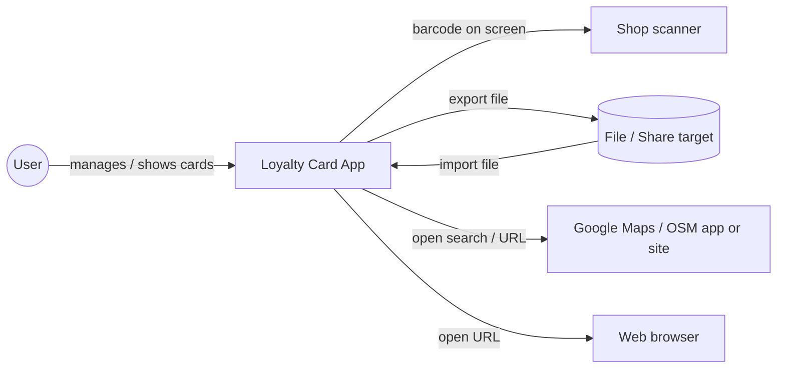
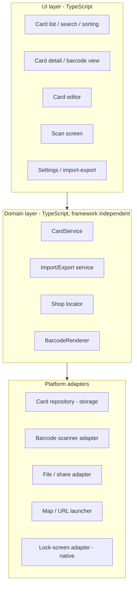

# MyCards – Architecture Documentation (arc42)

> **Status: DRAFT for discussion.** Nothing in this document is decided unless it is marked
> **[DECIDED]**. Proposals are marked **[PROPOSAL]**, open points **[OPEN Q-n]**.
> Implementation steps must reference the section / ADR they are based on.

---

## 1. Introduction and Goals

### 1.1 Requirements Overview

Source: initial request by the product owner (2026-11-08).

| ID   | Requirement                                                                                          | Priority  |
|------|------------------------------------------------------------------------------------------------------|-----------|
| F-01 | Manage loyalty cards (create, edit, delete, list), comparable to Catima                              | Must      |
| F-02 | Scan a card's barcode with the device camera                                                         | Must      |
| F-03 | Present a card's barcode quickly and readable for shop scanners                                      | Must      |
| F-04 | All data is stored locally on the device only                                                        | Must      |
| F-05 | Import and export of all data                                                                        | Must      |
| F-06 | Attach one or more websites to a card                                                                | Must      |
| F-09 | Attach photos to a card (e.g. front/back)                                                            | Must      |
| F-10 | Create a card manually (enter number and barcode format without scanning)                            | Must      |
| F-11 | Import/export in Catima-compatible format (compatibility mode), next to the own format               | Must      |
| F-07 | Search for the card's shop near the current location and show it in Google Maps or OpenStreetMap     | Must      |
| F-08 | Show barcodes on the lock screen without unlocking; user can swipe between cards, favorites first      | Optional  |
| N-01 | Android app, distributed via Google Play Store                                                        | Must      |
| N-02 | Prefer TypeScript / web technology, avoid Java/Kotlin where possible                                  | Should    |

Remaining scope questions: see section 11.2.

### 1.2 Quality Goals (to be prioritized – [OPEN Q-10])

| Candidate quality goal | Motivation                                                                 |
|------------------------|----------------------------------------------------------------------------|
| Speed of presentation  | At the checkout the card must be on screen within a few seconds            |
| Privacy                | Data never leaves the device unless the user exports it                    |
| Data safety            | No loss of cards (app update, phone change) – via import/export            |
| Maintainability        | Single developer, TypeScript-centric code base                             |
| Offline capability     | Core features (show/scan card) work without network                        |

### 1.3 Stakeholders

| Role                     | Who        | Expectations                                    |
|--------------------------|------------|-------------------------------------------------|
| Product owner / developer| APG        | TypeScript stack, Play Store release            |
| End user                 | tbd        | Fast card presentation, privacy                 |
| Google Play              | –          | Policy compliance (target API, data safety form) |
| Cashier / shop scanner   | –          | Readable barcode (brightness, size, quiet zone) |

---

## 2. Architecture Constraints

| Constraint                                           | Source / status |
|------------------------------------------------------|-----------------|
| Platform: Android only, **no iOS**                   | [DECIDED] PO, 2026-11-08 |
| Distribution: Google Play Store (AAB, Play App Signing, target-API requirement, Data-safety form, privacy policy URL) | Request / Google policy – current values to be verified at release time |
| Language: TypeScript; Kotlin only where unavoidable (lock-screen plugin) | [DECIDED] ADR-0001 |
| Framework: Capacitor + Angular                       | [DECIDED] ADR-0001, ADR-0002 |
| No backend / no cloud storage of user data           | Request (F-04)  |
| License: GNU GPL v3                                  | [DECIDED] ADR-0007 |
| Clean-room: **no code is copied from Catima** (or other card apps). Only Catima's export file format is implemented for compatibility. | [DECIDED] ADR-0007 |
| Documentation in Markdown, kept in this repository   | [DECIDED] PO, 2026-11-08 |
| Releases are built and published via GitHub Actions  | [DECIDED] ADR-0008 |

---

## 3. System Scope and Context

### 3.1 Business Context

### 3.2 Technical Context

| Neighbour             | Interface                                                         | Status |
|-----------------------|-------------------------------------------------------------------|--------|
| Camera                | Native camera + barcode decoder (e.g. Google ML Kit or ZXing)      | [OPEN Q-11] |
| Local storage         | SQLite / key-value / files in app sandbox                          | [OPEN] |
| File system           | Android Storage Access Framework / share sheet for import/export    | [OPEN] |
| Map apps              | Android intent with search query, user's map app (Google Maps, Organic Maps, OsmAnd, …) | [DECIDED] ADR-0005 |
| Location service      | Not used by the app (map app determines location)                  | [DECIDED] ADR-0005 |
| Lock screen           | Quick-Settings tile → native Activity shown over the lock screen     | [DECIDED] ADR-0006 |
| Google Play           | Play Developer API, used by GitHub Actions for uploads              | [DECIDED] ADR-0008 |
| Internet              | Not needed for core features; needed for in-app maps                | [OPEN Q-12] |

---

## 4. Solution Strategy

### 4.1 App technology – options

**[DECIDED] Option A – Capacitor, with Angular as UI framework** (ADR-0001, ADR-0002). Table kept for reference.

| Option | Description | TypeScript share | Barcode scan | Lock-screen (F-08) | Play Store | Remarks |
|--------|-------------|------------------|--------------|--------------------|------------|---------|
| **A. Capacitor** (+ React/Vue/Svelte/Angular) | Web app in an Android WebView, native plugins | ~100 % app code; small Kotlin plugin only for special features | Community plugins (ML Kit based) | Requires a small custom native plugin | Native AAB via Gradle | Closest to "TypeScript web application"; also runs in browser for dev |
| **B. React Native / Expo** | TS code, native UI components | ~100 % app code; native modules via Expo Modules API (Kotlin) for special features | `expo-camera` has built-in barcode scanning | Requires a custom native module / config plugin | AAB via EAS Build or local Gradle | Native look & performance; React only; not a "web app" |
| **C. PWA + Trusted Web Activity** (Bubblewrap) | Installable web app wrapped for Play | 100 % | Web `BarcodeDetector` / JS decoder (zxing-js) | **Not possible** | Possible, but requires hosting the PWA on an own domain (Digital Asset Links) | Data in browser storage (IndexedDB) – can be wiped with browser data; weakest fit for F-04/F-08 |
| D. NativeScript | TS with direct access to Android APIs | 100 % (native APIs called from TS) | Plugins | Possible from TS | AAB | Smaller community/ecosystem |
| E. Tauri 2 (mobile) | Web UI + Rust core | UI only | Official barcode plugin | Native code (Kotlin/Rust) | AAB | Adds Rust instead of Kotlin |

Note: F-08 (lock screen) needs a small amount of Kotlin in every option – there is no
pure-TypeScript way on Android to render on/over the lock screen.

### 4.2 Other strategy decisions (to be discussed)

| Topic | Options | Proposal |
|-------|---------|----------|
| UI framework | Angular | [DECIDED] ADR-0002. Component library (Ionic, Angular Material, own) [OPEN Q-4] |
| Persistence | SQLite plugin · key-value (Preferences) · JSON file in app sandbox | [PROPOSAL] SQLite for card data, photos as files in the app sandbox referenced from SQLite (ADR-0003) |
| Barcode rendering | `bwip-js` (many formats incl. Aztec, PDF417, DataMatrix) · `zxing` | `bwip-js`, renders offline |
| Export format | Own format + Catima compatibility mode | [DECIDED] ADR-0004. Details (container, encryption) open |
| Nearby shop search | Open external map app with search query – no location permission, no API key | [DECIDED] ADR-0005 |
| Lock-screen display | Quick-Settings tile → Activity over lock screen, swipe between cards, favorites first | [DECIDED] ADR-0006. Implementation variant open [OPEN Q-9] |
| Build & release | GitHub Actions building signed AAB + upload to Google Play | [DECIDED] ADR-0008. Tooling open [OPEN Q-14] |

---

## 5. Building Block View

*Draft, depends on section 4 decisions.*

Idea: domain logic is plain TypeScript with adapter interfaces, so it is unit-testable without a
device and independent of the chosen framework.

### 5.1 Domain model (draft – scope depends on [OPEN Q-5])

| Entity   | Attributes (candidate) |
|----------|------------------------|
| Card     | id, name/store, barcode value, barcode format, card number (display), color/icon, note, favorite/pinned, created/updated, last used |
| Website  | id, cardId, label, URL |
| Shop search | cardId, search term (default = store name) |
| Photo    | id, cardId, role (front/back/other), file reference |
| Optional | expiry date, balance, groups/tags, saved shop locations – [OPEN Q-5] |

---

## 6. Runtime View

*To be detailed after decisions.* Planned scenarios:

1. Add card by scanning
2. Show card at checkout (incl. max brightness / keep screen on / orientation)
3. Export all data → file / share target
4. Import data (merge vs. replace, duplicates)
5. Find nearby shop → open map
6. Show card on lock screen (optional)

---

## 7. Deployment View

*Draft.*

- Artifact: Android App Bundle (AAB), signed with an upload key; Play App Signing.
- Channels: internal testing → closed testing → production. (Google requires closed testing with a
  minimum number of testers for new personal developer accounts before production – verify current
  rules.)
- Source hosting: GitHub repository `mycards`.
- CI/CD: GitHub Actions – build, test, sign (upload key from GitHub Secrets), upload AAB to a Play
  track (ADR-0008). Note: the very first upload of a new app is usually done manually in the Play
  Console – verify when the developer account exists.

---

## 8. Cross-cutting Concepts (to be filled)

- Privacy & permissions (camera; location only if needed; internet only if needed)
- Data model versioning & migrations, export format versioning
- Error handling, logging (no remote telemetry?)
- Internationalization [OPEN Q-13]
- Accessibility, dark mode
- Testing strategy (unit tests for domain, E2E on emulator)
- Android Auto Backup: disable or allow? (conflicts with "local only" if enabled)

---

## 9. Architecture Decisions

Decisions are recorded as ADRs in [`adr/`](adr/) (template: [`0000-template.md`](adr/0000-template.md)).

| ADR | Topic | Status |
|-----|-------|--------|
| [0001](adr/0001-app-technology-capacitor.md) | App technology: Capacitor | accepted |
| [0002](adr/0002-ui-framework-angular.md) | UI framework: Angular | accepted |
| [0003](adr/0003-persistence.md) | Persistence | proposed |
| [0004](adr/0004-import-export-format.md) | Import/export: own format + Catima compatibility mode | accepted (details open) |
| [0005](adr/0005-shop-search-external-map-app.md) | Shop search via external map app | accepted |
| [0006](adr/0006-lock-screen-quick-settings-tile.md) | Lock screen via Quick-Settings tile | accepted (variant open) |
| [0007](adr/0007-license-and-clean-room.md) | License GPL v3, no code reuse from Catima | accepted |
| [0008](adr/0008-release-via-github-actions.md) | Releases via GitHub Actions | accepted (tooling open) |

---

## 10. Quality Requirements

*To be derived from section 1.2 once prioritized.* Example scenario: "From app start to barcode on
screen for a pinned card: ≤ 2 s on a mid-range device."

---

## 11. Risks, Technical Debt and Open Questions

### 11.1 Risks

| Risk | Mitigation |
|------|------------|
| Lock-screen feature needs native Kotlin and may behave differently across vendors / Android versions | Keep it optional, isolate in a small plugin, prototype (spike) early on real devices |
| Lock-screen screen could expose more than intended (e.g. whole app reachable without unlock) | Separate minimal Activity that only shows barcodes (ADR-0006) |
| Catima format changes or is under-specified | Version detection, tests with real Catima exports, compatibility mode documented separately |
| Accidental GPL/copyright issues from copying Catima code | Clean-room rule (ADR-0007), PR review |
| ML Kit barcode scanning depends on Google Play services (unbundled model) or increases APK size (bundled model) | Decide in ADR; ZXing as fallback |
| Data loss on uninstall (local only) | Prominent export, reminders? |
| Play policy changes (target API level yearly) | CI keeps SDK versions up to date |

### 11.2 Open Questions

Answered questions are removed and recorded as ADRs.

| ID | Question |
|----|----------|
| Q-1 | Repo visibility (public/private)? License identifier `GPL-3.0-only` or `GPL-3.0-or-later`? |
| Q-4 | UI component library: Ionic Framework (mobile look & feel, Angular support), Angular Material, or own design? |
| Q-5 | Further card fields: expiry date, balance, notes, groups/tags, colors/icons? |
| Q-6 | Additional barcode input: from image/screenshot? Which barcode formats are required (proposal: all formats Catima supports, for import compatibility)? |
| Q-7 | Own export format: container (JSON vs. ZIP with JSON + photos)? Password encryption? Import behaviour (merge vs. replace)? Catima compatibility: import only, or import and export? |
| Q-9 | Lock-screen implementation variant (see ADR-0006): native Activity showing pre-rendered barcode images (proposal) vs. Capacitor WebView in a restricted mode? Which cards appear – all, or only cards flagged "show on lock screen"? |
| Q-10 | Priority of quality goals (1.2) |
| Q-11 | Barcode decoder: Google ML Kit (via Play services) or ZXing (fully open source, no Google dependency)? |
| Q-12 | May the app request the INTERNET permission at all? (Not needed by any decided feature; opening websites/maps is done by other apps.) |
| Q-13 | Languages (EN, DE, …)? |
| Q-14 | Release tooling: Gradle Play Publisher, fastlane supply, or a GitHub Action; which tracks get automatic uploads (internal only / production)? |
| Q-15 | App lock (PIN/biometric) needed? |
| Q-16 | Minimum Android version / target devices (phones only, tablets)? |
| Q-17 | Android Auto Backup (Google Drive): disable to keep data strictly local, or allow? |

---

## 12. Glossary

| Term | Definition |
|------|------------|
| Card | A loyalty / membership / customer card represented by a barcode |
| AAB | Android App Bundle – Play Store upload format |
| TWA | Trusted Web Activity – Chrome-based wrapper to publish a PWA on Play |
| ADR | Architecture Decision Record |
